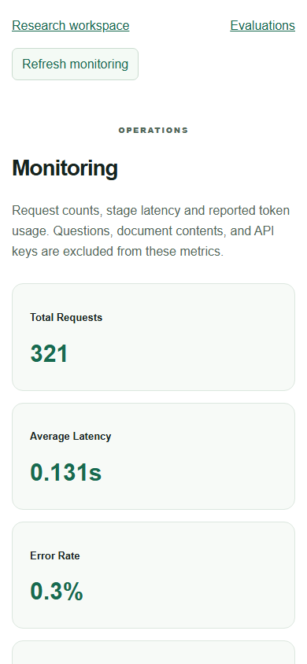
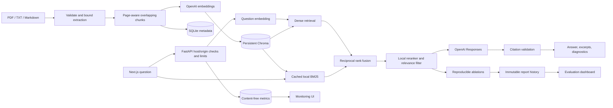

# CiteRAG

A document research workspace with page-aware citations, hybrid retrieval, and measured RAG evaluations. Next.js provides the green-and-white UI; FastAPI handles bounded document ingestion, OpenAI embeddings and Responses, embedded ChromaDB, and SQLite metadata/metrics.

The application works with real OpenAI calls. It also retains an explicit offline fixture provider for tests and demos. It never silently switches providers after a live API failure.

## What works

Upload PDF, TXT, or Markdown documents; inspect indexed chunk counts; delete sources; ask questions with configurable retrieval depth; render safe Markdown; copy answers; clear the visible conversation; and open numbered citations in an evidence panel. The workspace supports desktop/mobile, file selection and drag-and-drop.

Use dense or hybrid search for reliable evidence recall. Hybrid is the default; aggressive filtering with hybrid plus local reranking is experimental. Inspect original cosine similarity, BM25 score, fusion rank, reranker score, and selected candidates. These signals are rankings, not probabilities of correctness.

The evaluations dashboard includes configuration and run-history selectors, before/after charts, latency, citation quality, individual examples, and heuristic failure analysis. Monitoring shows request counts, stage timings, reported tokens, optional cost estimates, error rate, and retrieval configuration usage.

## Screenshots




Screenshots contain only the bundled public sample corpus. Generate new ones with `node scripts/capture-screenshots.mjs` from frontend while both servers run; that script submits no paid chat requests.

## Architecture



Document metadata and query metrics are separate SQLite files. PDF page numbers are one-based; text/Markdown use page 1. Existing chunks remain 900 characters with 160-character overlap within each page; this work did not re-index or alter the measured corpus.

## Retrieval and citations

Dense mode preserves the original cosine top-K retrieval. Hybrid mode combines dense and Okapi BM25 rankings using RRF with constant 60. Hybrid_rerank scores the bounded union with a local IDF-weighted sentence-coverage/cosine heuristic, filters below threshold, and passes up to final K chunks to generation. The operational default is hybrid with 20 candidates and K=5. Experimental reranking uses threshold .2, calibrated on the included sample set. An effective candidate pool cannot be smaller than final K.

The pure-Python default adds no runtime dependency. Optional `RERANKER=cross_encoder` uses a pre-provisioned local model, never downloads one, disables remote code, and falls back explicitly to the lightweight reranker. That optional model was not downloaded or benchmarked. Its threshold requires separate calibration. Keyword snapshots invalidate when persisted document IDs, timestamps, chunk counts, or vector count change. Corpora over the configured memory bound fall back explicitly to dense retrieval.

Every selected chunk gets a request-local marker and retains its persistent chunk ID, document name, page, excerpt, and score. Numeric markers are checked against actual selected chunks; nonexistent IDs are removed. Answers without valid evidence become an insufficient-evidence response. Refusal validation preserves supported explanations and cited partial answers after an uncertainty statement. Retrieved instructions are JSON-encoded untrusted data under fixed system instructions.

Marker validity is not entailment. Citation similarity preserves the existing clamped cosine convention; diagnostics expose original cosine scores, including negative values. Neither a high score nor a real marker guarantees factual support or resistance to prompt injection.

## Independent held-out assessment

The earlier 94.79% precision / 100% recall result is **in-sample**, from 16 questions also used to calibrate filtering. A new frozen assessment uses 40 different questions (32 answerable, eight unanswerable) over the same five-chunk corpus, plus a separate 12-question final set that remains unexecuted. This tests new questions over known facts, not unseen documents or domains.

| Held-out method | Source recall | Filename precision | Gold-evidence precision | Lexical F1 | Correctness judge | Strict abstention |
| --- | ---: | ---: | ---: | ---: | ---: | ---: |
| Dense | 100% | 38.75% | 26.25% | 68.85% | 100% | 3/8 |
| Hybrid | 100% | 38.75% | 26.25% | 70.83% | 100% | 4/8 |
| Hybrid + reranking | 84.38% | 85.42% | 85.42% | 60.36% | 87.50% | 5/8 |

The reranked filter lost complete or partial gold evidence in six answerable cases and fully refused four. Marker validity remained 100% among raw numeric markers, but answerable citation coverage fell to 87.5%; a real marker is not proof of complete factual support. Strict abstention requires no citations and is stricter than acknowledging missing information while citing related facts.

No threshold or reranker weight was retuned using these results. After the frozen assessment, the operational default was changed to hybrid and aggressive reranking labeled experimental; historical reports and the fixed evaluation protocol remain unchanged. The `.2` filter is unchanged and is not demonstrated to preserve recall generally. The new run uses a predeclared prompt clarification against unrequested verbosity and citation overclaims, applied equally to all three methods before evaluation. Historical-versus-held-out score differences also include different questions, labels and grading rules.

See [held-out results and failure analysis](docs/heldout-results.md), [answer-quality investigation](docs/answer-quality-findings.md), [release readiness](docs/release-readiness.md), and [publication drafts](docs/portfolio-copy.md). The dashboard labels splits and applicable metric denominators. Counts/tokens are not displayed as percentages.

From backend, reproduce only with explicit paid-call intent and a NEW output path:

```powershell
.venv/Scripts/python.exe -m app.eval.heldout --output evals/heldout-results/new-run
# Resume an interrupted run without regenerating completed paid work:
.venv/Scripts/python.exe -m app.eval.heldout --output evals/heldout-results/new-run --resume
```

This path never calibrates. It checks frozen dataset, prompt, source-code and corpus hashes. Completed reports are immutable. The reserved final test requires explicit opt-in and was not run in this phase. Unlike the original ablation command, this evaluator must be used for held-out data; the older ablation command is a development/calibration tool.

## Historical and calibrated in-sample results

The historical baseline, original dataset, and reports are preserved in `docs/baseline` with SHA-256 checks. Original `docs/openai-evaluation.json`, `docs/verification.md`, and the prior active report were not overwritten.

| Real run, 16 questions | Recall | Precision | Citation validity | Lexical F1 | Mean latency* |
| --- | ---: | ---: | ---: | ---: | ---: |
| Historical dense | 100% | 40% | 100% | 84.68% | 1.572s |
| Current dense | 100% | 40% | 100% | 85.29% | 1.339s |
| Hybrid | 100% | 40% | 100% | 84.63% | 1.268s |
| Hybrid + local reranking/filtering | 100% | 94.79% | 100% | 81.49% | 1.437s |

*Current ablations reuse a shared real query-embedding batch and exclude it and optional judging from per-question latency. Historical latency includes question embedding. No statistically established latency improvement is claimed.

All three previous in-sample configurations retained full expected-evidence token coverage. The previous calibrated run used 5,101 generation input tokens versus 8,657 for dense, a measured 41.08% reduction. Optional correctness, faithfulness, and citation-support judge averages were 1.0 after the recorded targeted refusal-regression recheck, with no missing scores. Model judgments are estimates, not proof. Lexical metrics fell; that tradeoff is retained in the reports.

Threshold calibration used the evaluation examples, so these are in-sample smoke-benchmark results. A dense top-1 control had perfect filename precision but only 94.49% expected-evidence token coverage. Add held-out, unanswerable, multi-source, and adversarial cases before claiming general retrieval gains. See [full comparison](docs/retrieval-comparison.md), [raw studies](docs/ablation), and [hardening-stage verification](docs/hardening-verification.md).

## Windows setup

Use Python 3.12 and Node.js 22 or newer. From the repository root in PowerShell:

```powershell
python -m venv backend/.venv
backend/.venv/Scripts/python.exe -m pip install --upgrade 'pip>=26.2,<27'
backend/.venv/Scripts/python.exe -m pip install -r backend/requirements.txt -c backend/requirements.lock.txt
Copy-Item backend/.env.example backend/.env
Copy-Item frontend/.env.local.example frontend/.env.local
cd frontend
npm.cmd ci
```

Copy environment templates only for a new setup; do not overwrite an existing configured .env. The current user's environment/key was preserved. Set OPENAI_API_KEY in backend/.env and keep CITERAG_DEMO=false. Never put that key in NEXT_PUBLIC variables or the browser. `npm.cmd` avoids PowerShell execution-policy issues; activating the virtual environment is optional.

Start from the repository root in separate terminals:

```powershell
cd backend
.venv/Scripts/python.exe -m uvicorn app.main:app --host 127.0.0.1 --port 8000 --no-access-log
```

```powershell
cd frontend
npm.cmd run dev
```

Open http://localhost:3000, http://localhost:3000/evaluations, http://localhost:3000/monitoring, and http://localhost:8000/docs. Upload backend/evals/sample.md, operations.txt, and verification.pdf. Ask "What is the maximum upload size?" or "What is the support escalation code?" The latter should cite PDF page 2. Questions are independent; prior conversation turns are not sent to the model.

## Configuration

| Variable | Default / purpose |
| --- | --- |
| OPENAI_API_KEY | Backend secret, required for real embedding/generation |
| OPENAI_CHAT_MODEL / OPENAI_EMBEDDING_MODEL | gpt-4.1-mini / text-embedding-3-small |
| CITERAG_DEMO | false; explicit offline fixtures only when true |
| RETRIEVAL_MODE | hybrid; dense also recommended, hybrid_rerank experimental |
| RETRIEVAL_CANDIDATES / RETRIEVAL_TOP_K | 20 / 5 |
| RELEVANCE_THRESHOLD | .2, calibrated for the bundled corpus and lightweight reranker |
| RERANKER / RERANKER_MODEL | lightweight; optional local-only cross_encoder path |
| MAX_KEYWORD_CHUNKS | 50000, bounds local BM25 snapshot size |
| CHROMA_PATH / SQLITE_PATH | ./data/chroma / ./data/metadata.sqlite3, relative to backend working directory |
| EVALUATION_PATH / EVALUATION_HISTORY_PATH | backend/evals/results.json and backend/evals/runs |
| CORS_ORIGINS | http://localhost:3000; explicit browser origins |
| ALLOWED_HOSTS | localhost,127.0.0.1,testserver; configure remote/custom hosts |
| OPENAI_TIMEOUT_SECONDS / OPENAI_MAX_RETRIES | 45 / 2, with bounded SDK exponential-backoff retries |
| RATE_LIMIT_REQUESTS / RATE_LIMIT_WINDOW_SECONDS | 60 mutations per client IP per 60 seconds, per process; 0 disables the limiter |
| MAX_PDF_PAGES / MAX_CHUNKS_PER_UPLOAD | 200 / 500 |
| MAX_EXTRACTED_CHARS | 2000000; upload byte limit remains 20 MB |
| METRICS_RETENTION_DAYS / LOG_QUERY_TEXT | 30 / false |
| CHAT_INPUT_USD_PER_MILLION / CHAT_OUTPUT_USD_PER_MILLION / EMBEDDING_USD_PER_MILLION | Unset: cost remains unknown; configure reviewed rates for your models |
| NEXT_PUBLIC_API_URL | http://localhost:8000, a browser-reachable build-time URL |

Restart the backend after changing environment variables. Rebuild the frontend after changing NEXT_PUBLIC_API_URL. Changing embedding models requires compatible re-indexing; changing rerankers requires new calibration.

## Evaluations and ablations

Use the unchanged 16-question JSONL dataset and the three indexed sample documents. All metrics come from actual runs; the UI never starts a paid evaluation by itself.

```powershell
cd backend
# A new ordinary run; choose a NEW output path to keep historical files untouched.
.venv/Scripts/python.exe -m app.eval.run --dataset evals/sample.jsonl --output evals/new-results.json --judge --retrieval-mode hybrid_rerank
# Retrieval-only study: one cached batch of real question embeddings.
.venv/Scripts/python.exe -m app.eval.ablation --output evals/ablations/my-new-retrieval-study
# Fresh answers and optional judges for A/B/C, reusing question vectors.
.venv/Scripts/python.exe -m app.eval.ablation --output evals/ablations/my-new-answer-study --answers --judge
# Retry only missing judges from an ordinary saved run.
.venv/Scripts/python.exe -m app.eval.run --output evals/new-results.json --retry-missing-judges
```

Output directories must be new. Raw outputs, retrieval diagnostics, corpus/dataset hashes, conditions, usage, and partial checkpoints are retained. Automatic resume of the older calibration ablation files is not implemented; the separate held-out runner does support resume without repeating saved generation or completed outcomes. Retrying missing ordinary-run judges avoids regenerating answers. Evaluation reports intentionally contain questions and excerpts: keep private runs in the ignored evals/data folders. Only the public synthetic examples are checked into docs.

Recall uses unique expected filenames; precision uses actual selected chunks; MRR uses the first expected filename. Lexical F1 excludes citation numbers. Faithfulness and citation-support overlap are lexical proxies. Citation validity checks the raw markers before cleanup. Optional structured LLM judges assess semantic correctness, faithfulness, and citation support. Missing judgments remain null and are counted. See the comparison report for calibration and timing limitations.

## Monitoring and privacy

Application request metrics are structured JSON with generated request IDs, UTC timestamps, stage durations, model names, reported input/output/total tokens, candidate/selected counts, and status. Provider exceptions, raw questions, and document contents are excluded. Health/docs/monitoring reads are not included in request aggregates. Trusted-host rejection happens outside application metrics.

Token/cost/configuration summaries cover the latest 1000 retained metric rows; the dashboard states this scope. Missing usage is unknown, and absent pricing is not treated as zero cost. Estimates use configured rates, exclude unreported failed/retry usage, and do not model provider discounts. Old SQLite query_logs from earlier versions remain and may contain private questions; they are not exposed by monitoring and need a separate retention decision.

## API

| Route | Purpose |
| --- | --- |
| GET /health | Process status, active provider, key-presence flag; no paid liveness call |
| GET /documents | Indexed document IDs, names, counts, timestamps |
| POST /documents | Multipart file upload; validates bounds before embeddings |
| DELETE /documents/{id} | Removes vectors and document metadata |
| POST /chat | Answer, structured citations, diagnostics, and telemetry |
| GET /retrieval/config | Default retrieval options and score interpretation |
| GET /evaluations | Preserved active report for backward compatibility |
| GET /evaluations/runs | Immutable run history metadata |
| GET /evaluations/runs/{uuid} | Selected raw report; identifiers validated |
| GET /monitoring | Content-free aggregates and recent request metrics |

```powershell
$payload = @{question='What is the maximum upload size?';top_k=5;retrieval_mode='hybrid_rerank';candidate_count=20;relevance_threshold=0.2} | ConvertTo-Json
Invoke-RestMethod http://localhost:8000/chat -Method Post -ContentType 'application/json' -Body $payload
curl.exe -F "file=@backend/evals/sample.md" http://localhost:8000/documents
```

Errors include 413 for size, 415 for unsupported type, 422 for invalid/empty or resource-excessive input, 429 for request rate limits, 503 for missing upload credentials, and redacted 502 provider failures. X-Request-ID links responses to metrics.

## Tests and security checks

```powershell
cd backend
.venv/Scripts/python.exe -m pytest -q
.venv/Scripts/python.exe -m pip check
.venv/Scripts/python.exe -m pip install -r requirements-dev.txt
.venv/Scripts/python.exe scripts/audit_dependencies.py
cd ../frontend
npm.cmd run typecheck
npm.cmd run build
npm.cmd audit
```

Runtime constraints in backend/requirements.lock.txt pin the tested dependency versions; Docker and CI apply them. They were verified against the local environment; Linux/container installation still needs Docker Engine verification.

Backend tests use isolated data and mocked/fixture providers, never real API calls. CI runs these checks without a key. Browser tests require both servers and Chromium:

```powershell
cd frontend
npx.cmd playwright install chromium
# Explicit paid-call opt-in for a real backend; default tests expect a separate demo backend.
$env:CITERAG_TEST_MODE='openai'
npm.cmd run test:e2e
```

Browser checks cover upload/drop/delete, chat, safe Markdown, citations, diagnostics, retrieval controls, clear/copy, run history, monitoring, responsive layout, and provider errors. Only the small real upload/chat workflows incur API calls; other browser interactions use saved reports or mocks. See docs/final-portfolio-verification.md for current counts and targeted reruns.

The raw Python audit retains four unique unpatched Chroma server advisories. The embedded-only applicability exception is exact-version scoped, documented, and time-limited; CI fails on unreviewed or expired findings. This is not a clean-audit claim. See [security review](docs/security.md). npm reported zero vulnerabilities at verification.

## Docker and deployment

```powershell
docker compose config --quiet
docker compose up --build -d
```

Backend and frontend images run as non-root users, include health checks, and use a durable data volume. Frontend uses a multi-stage standalone build. Compose waits for backend health and binds host ports to loopback. Browser requests use the public API URL; container loopback is used only for each container's own health check. No secrets are copied into images.

Compose validated. Docker Engine was unavailable, so container build/start and Linux volume ownership remain unverified. The production standalone frontend was tested locally. Read [deployment instructions](docs/deployment.md) for Vercel/Render configuration, durable paths, HTTPS, costs, cold starts, secrets, CORS, access protection, and backups. Nothing has been pushed or publicly deployed.

## Limits and next work

This is a hardened single-user portfolio application, not a multi-tenant service. It has no authentication, OCR, streaming answers, distributed quotas, background ingestion queue, or cross-store transaction. Duplicate uploads remain separate documents. Progress reports file-level indexing rather than byte-level transfer. In-memory rate limits and local files require one process/replica and a protected ingress for remote use.

The reranker is a transparent heuristic, and the benchmark is small and calibrated in-sample. Add held-out/adversarial labels, multiple relevant documents, human citation reviews, reranker-model comparisons, concurrency/load tests, and crash recovery/restore tests. Multi-user deployment needs tenant authorization/isolation, durable shared stores, distributed limits, and background ingestion. Review the unpatched dependency advisories before any architecture change.

## Contributing and license

MIT, selected by the repository owner. See LICENSE, CONTRIBUTING.md, and the local GitHub Actions workflow. CI configuration is prepared but has not run on GitHub because no push was authorized.

The current release copy, five topics, resume bullets, LinkedIn draft and portfolio description are in docs/portfolio-copy.md. The historical description below remains a concise project summary.

Suggested repository description: Document Q&A with hybrid BM25/vector retrieval, local reranking, page-aware citations, reproducible RAG ablations, and privacy-aware monitoring using Next.js, FastAPI, OpenAI, ChromaDB, and SQLite.

Resume wording:

- Built a hybrid RAG pipeline with BM25/vector fusion and local reranking, and documented its 16-question in-sample gain alongside the recall tradeoff exposed by a separate 40-question holdout.
- Implemented page-aware evidence citations, retrieval diagnostics, structured token/latency telemetry, and a responsive Next.js research and monitoring workspace.
- Added reproducible real-API ablations, privacy controls, regression tests, non-root Docker builds, and credential-free CI; measured token consumption with explicit corpus, quality and evaluation-split limitations.
