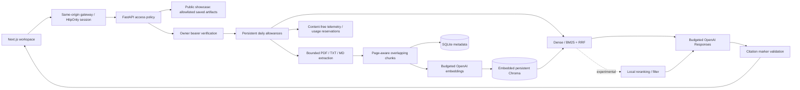
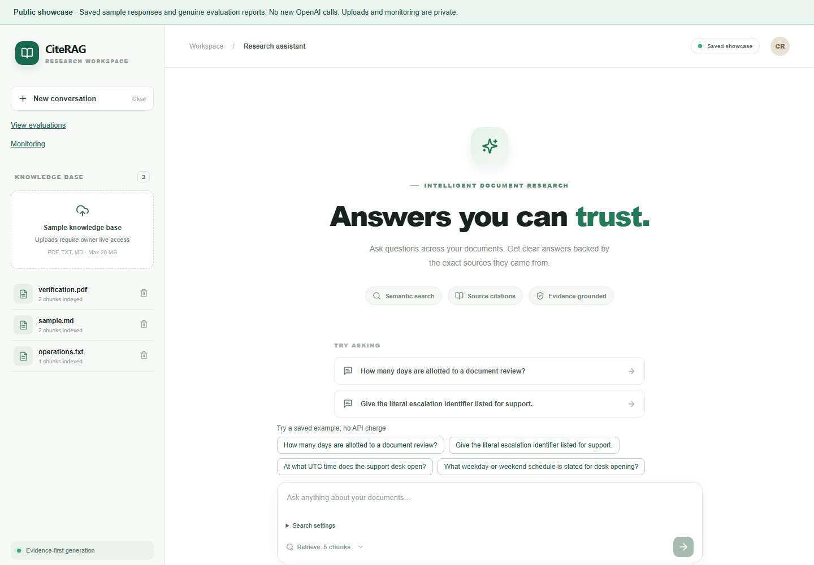
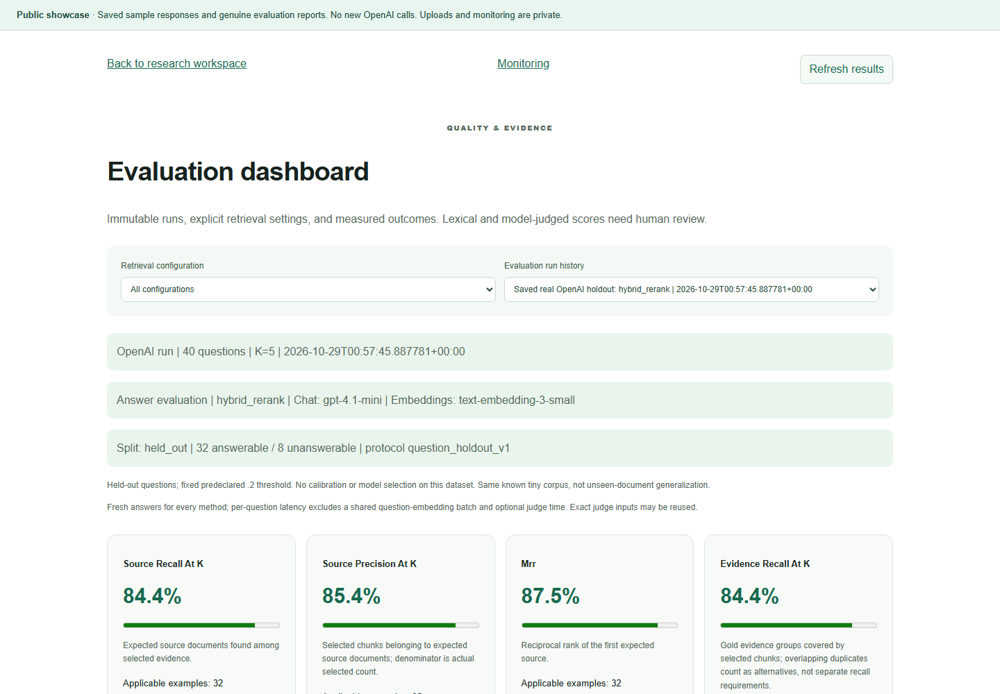
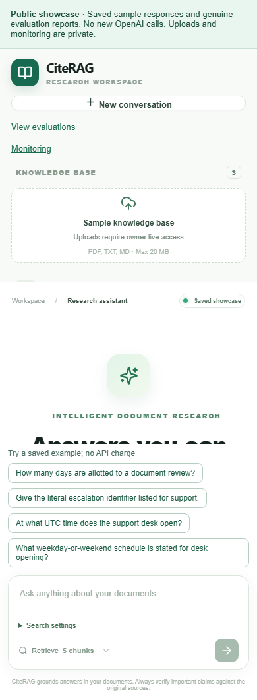

# CiteRAG

[](https://github.com/Shahidali78/citerag/actions/workflows/ci.yml)

A document research workspace that pairs answers with inspectable evidence and measures where retrieval fails. Built with Next.js, FastAPI, OpenAI, embedded ChromaDB and SQLite.

Explore saved examples without new model calls, or configure authenticated single-owner live access. Dense and hybrid retrieval are recommended. Aggressive reranking is experimental: its higher precision came with lower held-out recall and answer quality.

## Features and stack

- PDF, TXT and Markdown ingestion with bounded extraction and one-based PDF pages.
- Semantic retrieval, BM25/vector fusion, configurable retrieval depth and experimental local reranking.
- Safe Markdown answers, clickable citations, full excerpts, document/page/chunk IDs and retrieval diagnostics.
- Genuine saved evaluation reports, split labels, failure analysis, monitoring and estimated token costs.
- Replay-only public showcase; server-authorized live uploads, deletion, chat and private data access.
- Persistent daily allowances, output/context bounds, timeouts, rate limits and non-root Docker packaging.

| Layer | Implementation |
| --- | --- |
| UI and gateway | Next.js 15, React 19, TypeScript; same-origin server routes |
| API | FastAPI, Pydantic, Uvicorn |
| Models | OpenAI Responses: gpt-4.1-mini; embeddings: text-embedding-3-small |
| Retrieval/storage | Embedded Chroma PersistentClient, SQLite, BM25 and RRF |
| Verification | pytest, Playwright, pip-audit, npm audit, GitHub Actions |

## Architecture



Uploads split text into 900-character chunks with 160-character overlap within each page. PDF extraction keeps page numbers; TXT/Markdown use page 1. Real embeddings and offline fixture vectors use separate collections. Showcase reads bundled saved reports, never either runtime corpus.

## Screenshots





Screenshots contain only synthetic sample documents. See the verification record for when each screenshot was captured. The capture script makes no chat calls.

## Install and run locally

Requirements: Python 3.12 and Node.js 22, with Git and npm. Windows PowerShell:

```powershell
cd backend
py -3.12 -m venv .venv
.\.venv\Scripts\python.exe -m pip install -r requirements-dev.txt -c requirements.lock.txt
# Copy .env.example to .env ONLY if .env does not already exist.
$env:CITERAG_ACCESS_MODE='showcase'
.\.venv\Scripts\python.exe -m uvicorn app.main:app --reload --host 127.0.0.1 --port 8000 --no-access-log
```

In a second terminal:

```powershell
cd frontend
npm.cmd ci
npm.cmd run dev
```

Open http://localhost:3000 and http://localhost:3000/evaluations. The browser calls `/api`; Next.js forwards requests to the server-only `CITERAG_BACKEND_URL`, default `http://127.0.0.1:8000`. Set `CITERAG_FRONTEND_ORIGIN=http://localhost:3000` locally (the default), or the exact canonical HTTPS origin for a hosted deployment. Never use a public environment variable for secrets.

## Public showcase and protected live mode

`CITERAG_ACCESS_MODE=showcase` is the safe default. Sample buttons replay exact saved hybrid answers with their original citations. Unlisted questions receive an explanation rather than a generated answer. The dashboard displays genuine saved real-API reports. Uploads, deletion, runtime reports, monitoring and model clients are unavailable. No OpenAI key is needed for showcase operation.

For owner live use, configure backend environment values yourself:

| Variable | Purpose |
| --- | --- |
| CITERAG_ACCESS_MODE=live | Requires authentication on all data/model routes |
| CITERAG_ACCESS_TOKEN | Owner-supplied high-entropy token, at least 32 characters; no default secret |
| CITERAG_DEMO=false | Real OpenAI provider; no automatic fallback on failure |
| OPENAI_API_KEY | Backend-only provider credential |
| OPENAI_CHAT_MODEL / OPENAI_EMBEDDING_MODEL | Defaults gpt-4.1-mini / text-embedding-3-small |
| CHAT_INPUT_USD_PER_MILLION / CHAT_OUTPUT_USD_PER_MILLION / EMBEDDING_USD_PER_MILLION | Positive, owner-verified prices; paid calls fail closed if missing |

Generate/store the owner token with your password manager; do not reuse the OpenAI key. Sign in through the UI. The gateway stores the token in a one-hour HttpOnly, SameSite=Strict cookie, Secure on production HTTPS. The API verifies the bearer token independently. Browser JavaScript cannot read the cookie. Rotate the backend token to invalidate sessions immediately. `CITERAG_LOCAL_HTTP=true` is for local production-build tests only, never a public deployment. CI/browser fixture credentials are explicitly test-only and must never be used for deployment.

API clients need `Authorization: Bearer <owner-token>` in live mode. Only health/session status and CORS preflight are public. Evaluation execution remains an operator CLI task; there is no public evaluation-launch endpoint. Do not publish Swagger or private monitoring without authentication.

## Ingestion, retrieval and citations

Live mode accepts PDF, TXT and Markdown up to 20 MB. Validation also bounds pages, extracted characters and chunks. Scanned PDFs require external OCR. Runtime corpus data persists under `CHROMA_PATH` and `SQLITE_PATH`; do not mix embedding models in an existing collection.

Dense ranks cosine neighbors. Hybrid combines dense and BM25 through RRF (constant 60), with 20 candidates and K=5 by default. `hybrid_rerank` uses an IDF-weighted sentence-coverage/cosine heuristic and a .2 threshold calibrated on the original sample questions. Optional cross-encoder loading is local-only, disables remote code and was not benchmarked. All scores are ranking signals, not probabilities of correctness.

The model receives selected evidence as untrusted JSON data. Numeric markers must resolve to actual selected chunks; fabricated identifiers are removed. The evidence viewer shows filenames, pages, persistent IDs and excerpts. A real marker does not establish entailment or factual correctness. Prompt-injection resistance and semantic citation support need separate assessment.

## Evaluation methodology and results

Original calibration: 16 questions used to tune filtering. The earlier **94.79% precision / 100% recall** reranking result is in-sample.

Independent question-level holdout: 40 new questions, 32 answerable and eight unanswerable, over the same known five-chunk corpus. Another 12-question final reserve remains unexecuted. This is not unseen-document/domain generalization or externally blind annotation.

| Held-out method | Source recall | Filename precision | Gold-evidence precision | Lexical F1 | Correctness judge |
| --- | ---: | ---: | ---: | ---: | ---: |
| Dense | 100% | 38.75% | 26.25% | 68.85% | 100% |
| Hybrid | 100% | 38.75% | 26.25% | 70.83% | 100% |
| Hybrid + reranking | 84.38% | 85.42% | 85.42% | 60.36% | 87.50% |

Filtering lost complete or partial gold evidence in six answerable cases and fully refused four. Raw marker validity stayed 100%, but answerable citation coverage fell to 87.5%. Token reduction partly reflected missing context and refusals. Dense/hybrid are recommended; aggressive reranking remains experimental.

Reports distinguish filename relevance, gold-evidence recall/precision/MRR, lexical proxies, semantic judge scores, strict no-citation abstention, latency and observed usage. No metric was fabricated, unfavorable held-out answer regenerated, or threshold retuned after inspection. Historical report/dataset bytes are preserved. New runtime budget/output guards are outside the original frozen protocol; exact historical reproduction should use initial commit `c388ff5`, with a separately budgeted, explicitly authorized environment. Do not reuse the reserved final set for development.

See [full results](docs/heldout-results.md), [case study](docs/portfolio-case-study.md), [answer-quality analysis](docs/answer-quality-findings.md) and complete JSON in `docs/heldout/v1`. Saved reports do not imply the currently running provider generated them anew.

## Monitoring and cost controls

Private monitoring reports request IDs, timing stages, reported tokens, retrieval settings and estimated costs without questions, excerpts or credentials. Metrics retain 30 days by default. Legacy query logs may contain old questions and need owner review.

Live chat/upload requests consume `DAILY_REQUEST_LIMIT` (default 50). Every real SDK call reserves conservative input/output tokens and USD under `DAILY_TOKEN_LIMIT=200000` and `DAILY_USD_LIMIT=1`. SQLite write transactions serialize reservations across concurrent requests and survive restarts. Reservations include the SDK retry ceiling and are not refunded on failures or missing usage. UTC midnight resets the allowance; recent ledger history is retained for 31 days.

`MAX_OUTPUT_TOKENS=800`, `MAX_CONTEXT_CHARS=24000`, a 4000-character question bound, K<=12, candidate pool<=100, extraction/storage limits, timeouts and bounded retries limit each request. Missing model prices disable paid calls. Cost reservations and telemetry are estimates using owner-maintained rates, not guaranteed provider invoice limits; use a restricted OpenAI project and provider monitoring too.

## Tests and GitHub Actions

```powershell
cd backend
.\.venv\Scripts\python.exe -m pytest -q
.\.venv\Scripts\python.exe -m pip check
.\.venv\Scripts\python.exe scripts/audit_dependencies.py
cd ../frontend
npm.cmd ci
npm.cmd run typecheck
npm.cmd run build
npm.cmd audit
npx.cmd playwright install chromium
npm.cmd run test:portfolio
```

The portfolio browser harness starts isolated loopback fixtures, clears the provider key, uses temporary databases and tests both access modes on desktop/mobile. It never calls OpenAI. A fixed credential in that harness is only a test fixture, not a deployment secret. Normal tests also mock providers. Historical real-API tests and benchmarks are not rerun automatically.

CI runs Python installation, consistency, pytest and scoped audit; frontend npm ci, TypeScript, build and npm audit. Ubuntu 24.04 and verified official action commit SHAs reduce drift; Python/Node dependencies use lock constraints. The badge follows `ci.yml` on `main`, so this feature branch's changes only appear there after an approved merge. See the feature verification record for actual counts and limitations.

## Security model

Server authorization protects every live corpus, monitoring, report and mutation route. Showcase exposes only allowlisted public files. Secrets are backend-only; environment files, uploads, databases and runtime logs are ignored. The gateway validates the configured origin for mutations, forwards no browser authorization header and uses no-store responses. Trusted hosts, explicit CORS, content limits and request throttling add defense in depth.

Four unpatched ChromaDB 1.5.9 advisories remain under exact-version embedded-only exceptions. This is not a clean Python audit. The application never exposes Chroma server routes, remote embedding-function configuration or model downloads. The exception expires for review on 2026-11-29; CI fails on expired/unreviewed findings. See [security review](docs/security.md).

## Docker and protected deployment

```powershell
docker compose config --quiet
docker compose up --build -d
# Normal shutdown preserves the named data volume:
docker compose down
```

Images run as non-root and never copy secrets. Compose defaults to showcase, binds ports to loopback, waits for backend health and retains data on a named volume. Browser traffic uses the Next.js gateway; container-to-backend traffic uses `http://backend:8000`. Do not run `down -v` on data you need.

Docker Engine was unavailable during preparation; image builds, container persistence and Linux volume ownership remain unverified. [Deployment instructions](docs/deployment.md) cover Vercel/Render, HTTPS, explicit origins, secret setup, persistent paths, cost estimates, backup/restore, rollback and approval gates. No public application deployment or paid resource is authorized by this work.

## Limitations and future improvements

Single-owner access is not tenant isolation. Use one API worker/replica with local SQLite/Chroma and an edge limiter; serverless gateway throttling alone is not a global quota. The persistent backend ledger is the paid-call control. PDF parsing is bounded but not sandboxed. Ingestion has no background queue or cross-store transaction. Provider estimates are not billing guarantees. The current benchmark is small and known-document; external review, unseen-document evaluation, stronger abstention and adversarial/load testing remain future work.

## Portfolio and license

[Case study](docs/portfolio-case-study.md), [GitHub copy](docs/github-project-description.md), [resume bullets](docs/resume-bullets.md), [LinkedIn draft](docs/linkedin-announcement.md). Copy is prepared only, not posted. MIT; see [LICENSE](LICENSE) and [CONTRIBUTING.md](CONTRIBUTING.md). Changes are reviewed on a feature-branch pull request; merge and deployment require owner approval.
